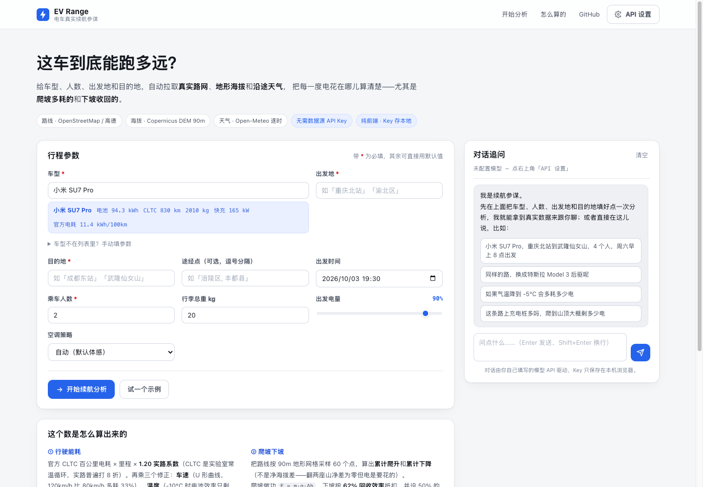
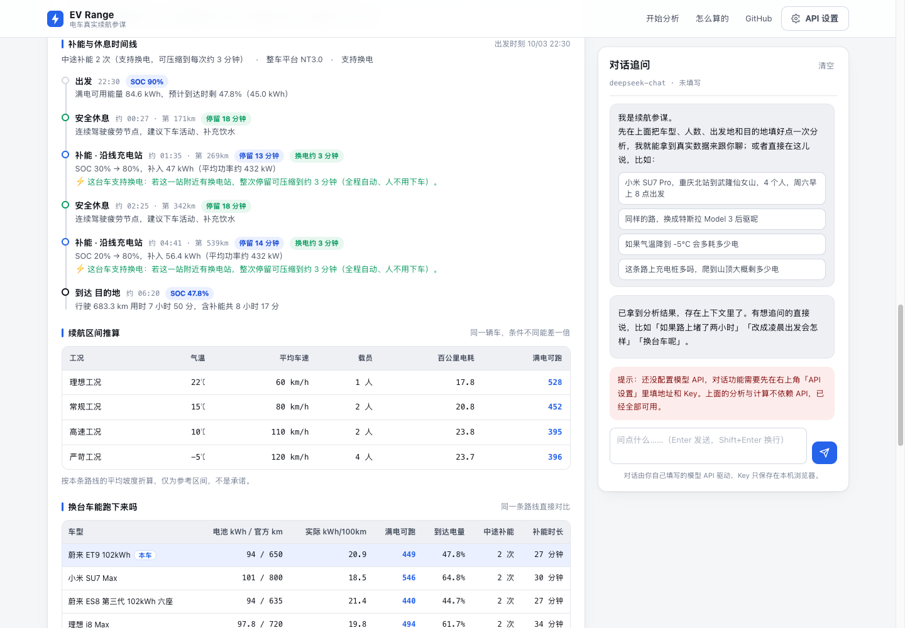
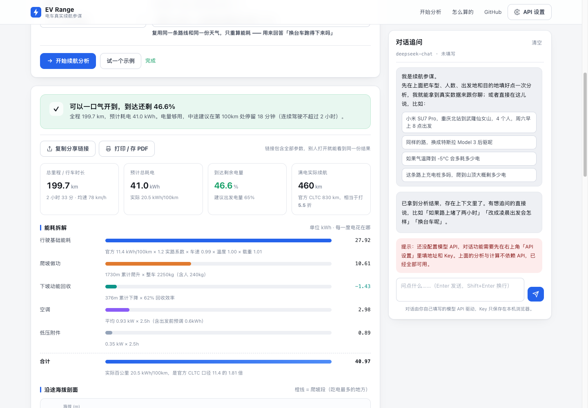
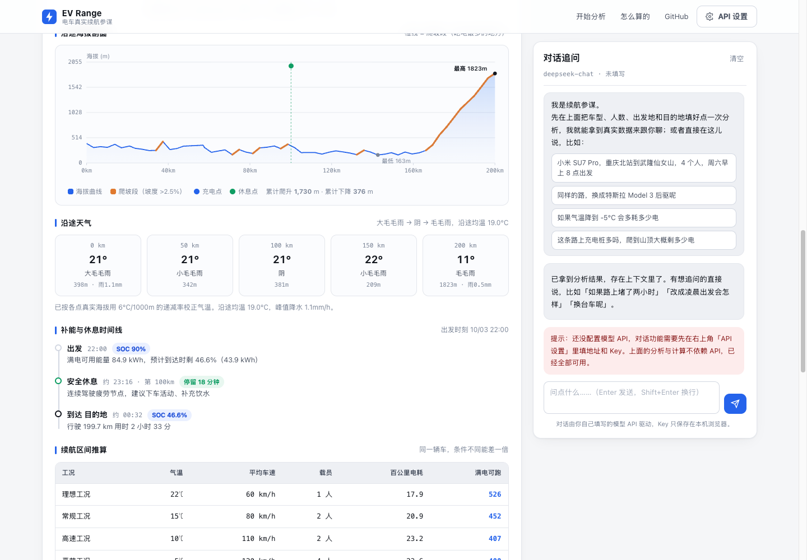
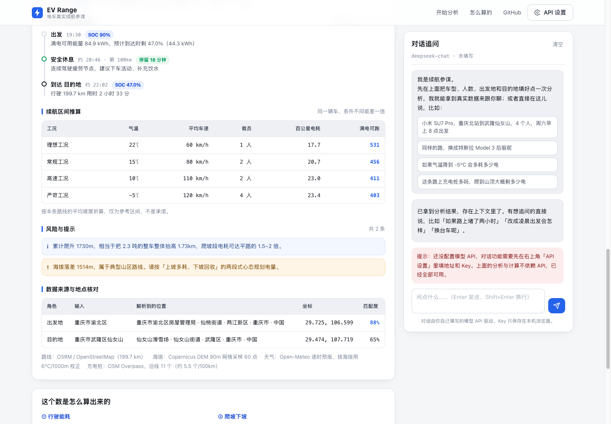
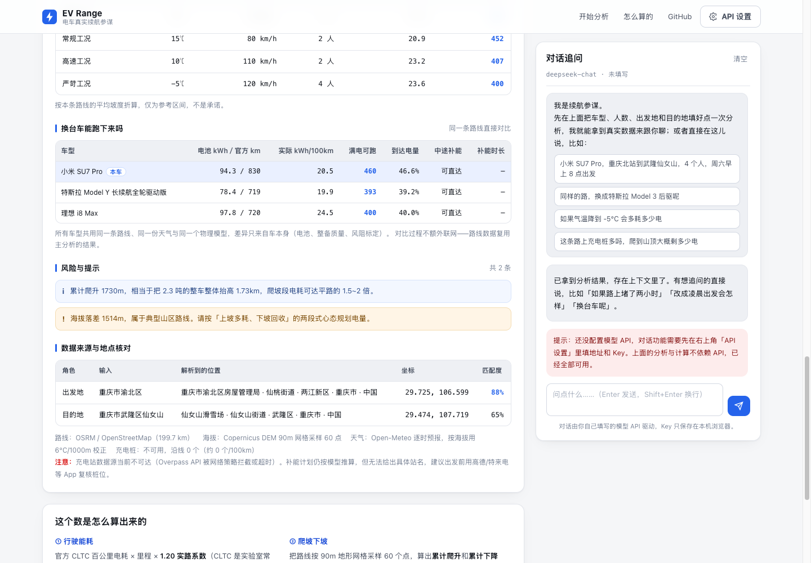
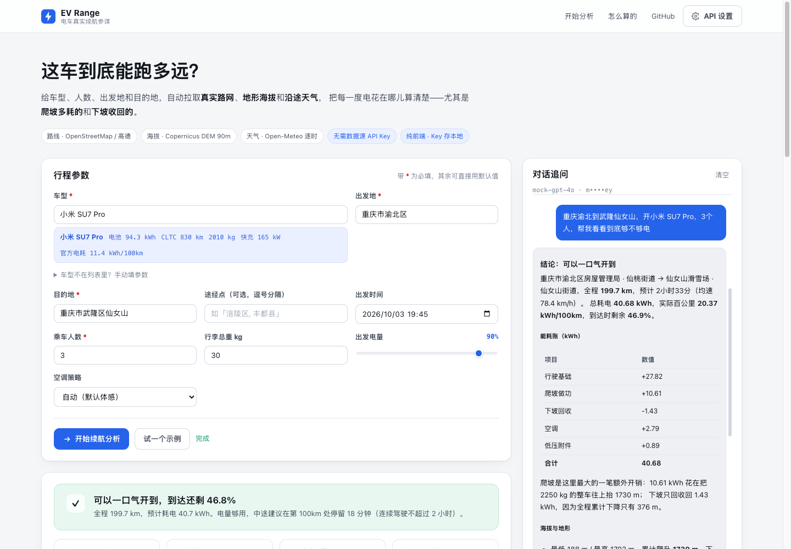

# EV Range · Trip Energy Estimates

Estimate trip energy from a car, passenger count and route, using elevation, weather and payload. Uphill consumption and downhill recovery are shown separately.

[中文](README.md)

A static browser application with no backend or build step. Default map, terrain and weather sources require no data API key. Optional chat needs your own OpenAI-compatible model endpoint and credentials, stored in your browser.

Compare cars on the same route, share trip inputs by link, or print a report. This tool uses formulas and empirical parameters; it does not have vehicle-wide real-world calibration results. Data failures are flagged, and actual charge and charging conditions still need checking before travel.

**[Open the app](https://leruo212.github.io/ev-range-agent/)** · **[Prefilled example](https://leruo212.github.io/ev-range-agent/?demo=1)**



## Energy Model

The calculation and parameters are in `js/model.js`.

| Component | Calculation |
|---|---|
| Driving | Rated consumption × distance × default 1.20 road factor, with speed, temperature, payload, precipitation and approximate wind corrections |
| Climbing | `m × g × cumulative ascent`, including passengers and luggage |
| Descent recovery | `m × g × cumulative descent × 0.62`, capped at 50% of driving energy |
| HVAC and accessories | Heating or cooling power × trip duration, preconditioning when enabled, plus low-voltage loads |

Speed and temperature use piecewise empirical curves. At 80 km/h the speed factor is 1.0; at 120 km/h it is 1.33. These are model assumptions, not guarantees for an individual car.

### Charging, Rest and Battery Swaps

The planner uses 20%–80% charging segments, a 15% suggested minimum arrival charge, and 72% of peak DC power as an average charging assumption, plus six minutes per stop. Rest suggestions use two hours or 200 km and are merged with charging stops.

The catalogue marks swap-capable NIO and Onvo models. For those entries, output includes both charging time and an indicative three-minute swap. Station stock and queues are not guaranteed. Platform labels, peak charging figures and battery capacities are reference values from the built-in catalogue; check the exact model year and configuration yourself.




## Elevation Profile

The route is sampled at 60 points against terrain elevation data. A five-point moving average reduces noise before cumulative ascent and descent are calculated. Segments with gradients above 2.5% are highlighted.

The recorded noise simulation reduced false ascent on a flat route from 236 m to 47 m, at the cost of smoothing short climbs. In the documented Chongqing–Wulong example, the route was 199.7 km with 1,730 m ascent and 376 m descent; these are example outputs, not fixed results for future queries.




## Sharing, Comparisons and Printing

- **Share inputs:** the URL encodes origin, destination, waypoints, car, passengers, luggage, charge, HVAC, departure time and comparison cars. Credentials are excluded. Opening the link queries route and weather data again, so results may change.
- **Compare cars:** reuse the fetched route, terrain and weather and rerun the local energy model. The selected car stays first in the table. The form accepts up to three additional models; the comparison function handles up to five entries.
- **Print:** the print view hides controls and chat, retaining results, input parameters and source notes. Use the browser's print dialog to save a PDF.



## Optional Chat

Configure an OpenAI-compatible endpoint that supports function calling. The agent exposes these tools and displays their calls:

| Tool | Purpose |
|---|---|
| `analyze_trip` | Route, elevation, weather, chargers, energy and charging plan |
| `compare_cars` | Compare models on one route |
| `estimate_energy` | Recalculate under different weather or payload assumptions |
| `plan_route` | Route lookup |
| `get_weather_along_route` | Weather lookup |
| `find_charging_stations` | Charger lookup |
| `search_car_model` | Search the built-in car catalogue |

Prompts require numbers to come from tools. If a model does not support tool calls, the interface reports the fallback to chat-only mode.



## Data Sources and Car Catalogue

| Purpose | Default source | With an Amap key |
|---|---|---|
| Geocoding | Photon / OpenStreetMap | Amap Geocoding |
| Route | OSRM public instance | Amap driving routes |
| Elevation | Open-Meteo / Copernicus terrain | Same |
| Weather | Open-Meteo hourly forecasts | Same |
| Chargers | Overpass / OpenStreetMap | Amap POI search |

The catalogue contains 51 reference entries across brands including Tesla, BYD, NIO, Onvo, XPeng, Li Auto, Xiaomi and others. Search by model, brand or catalogue labels such as platform and swap support. For an unlisted car, enter battery capacity and rated range manually; additional parameters can be overridden in the interface.

Chinese place-name handling in `js/geo.js` splits queries at administrative suffixes, searches for a city anchor, retries shorter queries with location bias and penalises distant matches. The documented 20-query check matched the correct city for all 20 and the intended POI for 19. That sample does not establish general accuracy; inspect resolved coordinates for ambiguous or small places.

## Run Locally

```bash
git clone https://github.com/Leruo212/ev-range-agent.git
cd ev-range-agent
python3 -m http.server 8788
# Open http://localhost:8788/
```

Serve over HTTP: opening `index.html` as `file://` can fail because of module loading restrictions. No npm installation or bundling is needed. For GitHub Pages, select the `main` branch root; `.nojekyll` is included.

## Model Settings and Privacy

In API settings, enter the base URL, key and model ID. The base URL can end in `/v1` or the full `/chat/completions` path. Presets cover several compatible providers and local Ollama. The endpoint must allow requests from the browser.

Model settings are stored in this browser's localStorage. Requests go directly to the configured provider; this project has no backend proxy. Other devices and browsers need their own settings. Shared trip links exclude credentials. Optional Amap credentials improve domestic route and POI lookups.

## Limitations

- There is not enough real-car comparison data to claim a general error bound. Assumptions may be inaccurate for a particular vehicle or extreme conditions.
- Terrain elevation is not road-surface elevation; tunnels, bridges and short steep slopes can be poorly represented.
- Weather, geocoding, routing and charger data depend on external services. Fallbacks are reported, but a fallback estimate can be less accurate.
- Charger coverage is uneven. Confirm stops in a dedicated charging app before departure.
- The model does not capture individual driving style, battery ageing, detailed traffic or service-area queues.
- Car parameters vary by model year. The 51 catalogue entries are reference values and can be overridden.

## Structure and Recorded Checks

```text
index.html       Page structure
css/style.css    Responsive and print styles
js/app.js        Form, analysis, chat and settings
js/ui.js         Results, charts and timeline
js/agent.js      Model client, tools and agent loop
js/trip.js       Data acquisition and analysis orchestration
js/model.js      Energy model and charging/rest planner
js/geo.js        Data sources and place-name handling
js/evdb.js       Car catalogue
js/config.js     Local settings
docs/            Screenshots
```

The project documents numerical checks of climbing energy, elevation-noise simulations, the 20-place geocoding sample, car comparisons, input-link round trips, printed output and a mock model/tool-call flow. Data-service availability is network-dependent; Overpass uses mirror retries and a timeout. These are recorded development checks, not a guarantee of future service availability.

## Use and Licence

Estimates are for trip planning. Actual consumption depends on driving, roads, load, tyre pressure and battery condition, among other factors.

[MIT](LICENSE) © 2026 M1r4th0R
